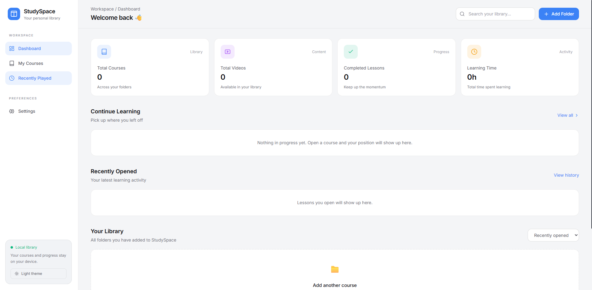

# StudySpace

StudySpace is a local-first web application that turns a folder of already-downloaded course files into a personal learning library. Point it at a folder on your disk, and it detects the lessons, streams them in the browser, and tracks your progress — resuming exactly where you left off the next time you open it.

The app runs entirely on your own machine. It binds to loopback only, stores its database in your OS app-data directory, and never touches, moves, or deletes the media files you add.

## Features

- **Add a course** — choose a folder via your operating system's native folder dialog, or paste a path directly
- **Automatic lesson detection** — video, audio, PDF, and text files are identified and grouped into sections by subfolder
- **Review before saving** — a confirmation screen lists everything that was detected so you can untick what you don't want
- **In-browser playback** — video, audio, PDF, Markdown, and HTML lessons with seek and full keyboard control
- **Persistent progress tracking** — playback position, completion, and watched percentage survive a full restart
- **Resume where you left off** — reopen a lesson and jump straight to the second you stopped at
- **Bookmarks and notes** — timestamped markers and a per-lesson note, both saved as you type
- **Search and sort** — filter your library by title and sort by recently opened, name, or progress
- **Rescan reconciliation** — add new files, and deleted files are marked missing rather than removed, so their progress is preserved
- **Move-safe library** — rename or relocate a course folder on disk and rescan; every lesson keeps its progress, bookmarks, and notes
- **Remove with undo** — deleting a course removes database rows only, and the toast offers a one-click undo
- **Dark and light themes** — persisted locally and server-side, so the choice follows you across browsers
- **Native folder picker** — raises the real OS dialog (Windows, macOS, or Linux) rather than a browser approximation
- **Graceful error handling** — missing drives, deleted files, and unreadable folders produce clear messages instead of stack traces

## Project Screenshot



## Tech Stack

- **Node.js** `22.12+`
- **Express** `4` — JSON API and media streaming
- **React** `19` — single-page application
- **react-router** `8` — client-side routing
- **Vite** `8` — dev server with HMR and production builds
- **Tailwind CSS** `4` — token-driven utility styling
- **SQLite** — via the built-in `node:sqlite` module, with a `better-sqlite3` fallback
- **JavaScript (ESM)**
- **React Context API** — toast, confirm, and theme providers
- **React Hooks** — `useMediaProgress`, `useTheme`
- **Node built-in test runner** — `node:test`, no test framework dependency
- **Playwright** — browser smoke tests

## Prerequisites

Before running the project, make sure you have the following installed:

- Node.js **22.12 or newer** (the app uses the built-in `node:sqlite` module; `react-router` v8 requires Node ≥ 22.22)
- npm

No database server, no Docker, and no native compilation step are required. On older runtimes the app falls back to `better-sqlite3` if it is installed.

## Running Locally

### 1. Clone the repository

```bash
git clone https://github.com/itzlutfur/CourseStream.git
```

### 2. Navigate to the project directory

```bash
cd CourseStream
```

### 3. Install dependencies

```bash
npm install
```

### 4. Start the development server

Development runs as two processes — the Express API and the Vite dev server. Start each in its own terminal:

```bash
npm run server:dev   # Express API on http://127.0.0.1:4317
npm run dev          # Vite dev server on http://127.0.0.1:5173
```

Open **http://127.0.0.1:5173**. Vite serves the React app with hot module replacement and proxies `/api` and `/player` through to Express, so the development environment behaves exactly like production.

### 5. Create a production build

```bash
npm run build
```

This emits the compiled SPA into `public/dist/`.

### 6. Run the production build

```bash
npm start
```

Express serves the built SPA and the API together on **http://127.0.0.1:4317**, incrementing to `4327` if the port is busy. Your default browser opens automatically once the server is listening.

### 7. Run the tests

```bash
npm test
```

Uses the Node built-in test runner. Two additional smoke-test scripts exercise the full stack against a running server:

```bash
# HTTP smoke test across the whole API
node test/e2e-check.mjs http://127.0.0.1:4317 "C:\path\to\a\course-folder"

# Browser smoke test driving the React UI with Playwright
npm install --no-save playwright && npx playwright install chromium
node test/ui-check.mjs http://127.0.0.1:4317 "C:\path\to\a\course-folder"
```

### Command-line flags and environment variables

| Flag / Variable | Effect |
|---|---|
| `--no-open` | Do not open a browser on startup |
| `--verbose` | Log port-fallback attempts |
| `CI=1` | Suppresses the browser launch |
| `COURSESTREAM_DATA_DIR` | Overrides the database location — useful for testing |

```bash
COURSESTREAM_DATA_DIR=/tmp/cs-test npm start -- --no-open
```

## API Reference

The server exposes a JSON API under `/api/*` and streams media under `/player/*`.

| Method | Endpoint | Purpose |
|---|---|---|
| `GET` | `/api/dashboard` | Courses, continue-watching card, stats, theme, sort preference |
| `POST` | `/api/dashboard/theme` | Persist the theme preference |
| `POST` | `/api/dashboard/sort` | Persist the dashboard sort order |
| `POST` | `/api/dashboard/playback-speed` | Persist the default playback speed |
| `POST` | `/api/courses/scan` | Scan a folder and return the detected lessons for review |
| `GET` | `/api/courses` | List every course in the library |
| `POST` | `/api/courses` | Create a course from a reviewed selection |
| `GET` | `/api/courses/:id` | One course and its lessons grouped by section |
| `PATCH` | `/api/courses/:id` | Rename a course |
| `DELETE` | `/api/courses/:id` | Remove a course and return a restorable snapshot |
| `POST` | `/api/courses/restore` | Restore a previously removed course |
| `POST` | `/api/courses/:id/rescan` | Re-run detection and reconcile against disk |
| `GET` | `/api/lessons/:lessonId` | Lesson detail, course, prev/next, progress, notes |
| `GET` | `/api/progress/:lessonId` | Saved position, watched percentage, resume offer |
| `POST` | `/api/progress/:lessonId` | Save playback position |
| `POST` | `/api/progress/:lessonId/complete` | Toggle manual completion |
| `GET` | `/api/progress/:lessonId/bookmarks` | List bookmarks for a lesson |
| `POST` | `/api/progress/:lessonId/bookmarks` | Add a bookmark at the current time |
| `PATCH` | `/api/progress/:lessonId/bookmarks/:bookmarkId` | Rename a bookmark |
| `DELETE` | `/api/progress/:lessonId/bookmarks/:bookmarkId` | Delete a bookmark |
| `GET` | `/api/progress/:lessonId/notes` | Read a lesson's note |
| `PUT` | `/api/progress/:lessonId/notes` | Save a lesson's note |
| `POST` | `/api/pick-folder` | Raise the OS folder dialog and return the chosen path |
| `GET` | `/player/:lessonId/stream` | Stream media with byte-range support |
| `GET` | `/player/:lessonId/document` | Serve a document lesson (PDF, Markdown, HTML) |

Full request and response shapes are documented in [`docs/api.md`](docs/api.md).

## Project Structure

```text
CourseStream/
├── package.json
├── vite.config.js              ← Vite config: build output + dev proxy
├── plan.md                     ← the original design document
├── README.md
├── docs/                       ← extended documentation
│   ├── README.md               ← documentation index
│   ├── api.md                  ← HTTP API reference
│   ├── architecture.md         ← code organisation and rationale
│   ├── features.md             ← every user-facing feature
│   ├── known-issues.md         ← open bugs and plan gaps
│   └── development.md          ← running, testing, extending
├── src/                        ← the server
│   ├── server.js               ← entry point, app wiring, port, browser open
│   ├── config.js               ← paths, port, limits, constants
│   ├── db/
│   │   ├── index.js            ← connection, pragmas, query helpers, migrations
│   │   └── schema.sql          ← DDL
│   ├── lib/
│   │   ├── scanner.js          ← folder → detected lesson list
│   │   ├── media.js            ← mime map, extension map, range parsing
│   │   ├── duration.js         ← MP4/M4A container duration probe
│   │   ├── progress.js         ← completion rules, course stats
│   │   ├── courses.js          ← course CRUD, rescan reconciliation
│   │   ├── nativePicker.js     ← OS-native folder dialog (WinForms / osascript / zenity)
│   │   ├── paths.js            ← path normalisation, traversal guard
│   │   └── settings.js         ← key/value settings
│   └── routes/
│       ├── index.js            ← route registration, 404, error handler
│       ├── api-dashboard.js    ← GET /api/dashboard, settings
│       ├── api-courses.js      ← /api/courses/*
│       ├── api-lessons.js      ← GET /api/lessons/:id
│       ├── player.js           ← /player/:id/stream, /player/:id/document
│       ├── progress.js         ← /api/progress/*
│       └── pick-folder.js      ← POST /api/pick-folder
├── client/                     ← the React front-end
│   ├── index.html              ← SPA shell: <div id="root">
│   └── src/
│       ├── main.jsx            ← createRoot + BrowserRouter + providers
│       ├── index.css           ← Tailwind import + StudySpace design tokens
│       ├── App.jsx             ← AppShell + Routes
│       ├── api/
│       │   ├── client.js       ← fetch wrapper, error normalisation
│       │   ├── courses.js      ← dashboard, courses, scanning, settings
│       │   ├── lessons.js      ← lesson detail
│       │   ├── progress.js     ← progress, bookmarks, notes
│       │   └── pickFolder.js   ← native folder picker request
│       ├── components/
│       │   ├── AppShell.jsx    ← sidebar shell + main outlet
│       │   ├── Sidebar.jsx    ← logo, nav, local-library status panel
│       │   ├── PageHeader.jsx ← eyebrow + title + actions
│       │   ├── StatCard.jsx   ← dashboard statistic tile
│       │   ├── CourseCard.jsx ← course card, both variants
│       │   ├── icons.jsx      ← inline SVG icon set
│       │   ├── Toaster.jsx    ← toast context/provider
│       │   ├── ConfirmModal.jsx ← promise-based confirm
│       │   ├── Modal.jsx      ← generic modal shell
│       │   ├── ProgressBar.jsx ← progress track
│       │   └── Markdown.jsx   ← markdown → React elements
│       ├── pages/
│       │   ├── Dashboard.jsx
│       │   ├── MyCourses.jsx
│       │   ├── AddCourse.jsx
│       │   ├── CourseRedirect.jsx
│       │   ├── Player.jsx
│       │   ├── Settings.jsx
│       │   └── NotFound.jsx
│       ├── hooks/
│       │   ├── useTheme.js        ← localStorage + server persistence
│       │   └── useMediaProgress.js ← autosave, sendBeacon
│       └── utils/
│           ├── format.js       ← time, bytes, date formatting
│           └── courseTarget.js ← which lesson a course opens on
├── public/
│   └── dist/                   ← Vite build output (generated)
└── test/
    ├── progress.test.js        ← completion, resume, stats
    ├── media.test.js           ← mime, ranges, path traversal
    ├── integration.test.js     ← course CRUD + snapshot restore
    ├── e2e-check.mjs           ← HTTP smoke test against a running server
    └── ui-check.mjs            ← Playwright browser smoke test
```

## Application Architecture

### Front-end

The client is a React single-page application. The server renders no HTML — it serves a JSON API, the media streams, and one static shell that the client-side router takes over.

| Route | Page | Purpose |
|---|---|---|
| `/` | Dashboard | Stat tiles, Continue Learning, Recently Opened, library grid |
| `/courses` | MyCourses | Summary tiles, search, status filter, course grid |
| `/courses/add` | AddCourse | Locate a folder, then review the detected lessons |
| `/courses/:id` | CourseRedirect | Redirects to the course's player page |
| `/player/:lessonId` | Player | Full-screen playback, playlist rail, bookmarks, notes |
| `/settings` | Settings | Library, playback, appearance, progress & data |
| `/dashboard` | — | Legacy path, redirects to `/` |
| `*` | NotFound | Catch-all |

The player renders outside `AppShell` — it is a full-screen layout with its own sticky header and a 380px playlist rail, while every other page sits inside the sidebar shell. `App.jsx` branches on the path to decide which.

Shared behaviour lives in React primitives rather than a global object:

| Capability | Implementation |
|---|---|
| API calls | `apiFetch()` in `client/src/api/client.js` |
| Toasts | `<ToastProvider>` + `useToast()` |
| Confirmation dialogs | `<ConfirmProvider>` + `useConfirm()` |
| Theming | `useTheme()` — localStorage plus server persistence |
| Progress autosave | `useMediaProgress()` — 5-second debounce, pause save, `sendBeacon` flush |

Side effects that used to live in page scripts are now `useEffect` hooks. The server stays the single source of truth: screens render from an API response and refetch after a mutation, so there is no client-side cache to invalidate.

### Back-end

Express exposes a JSON API under `/api/*` and streams media under `/player/*`. Anything else is served the single `public/dist/index.html` shell, so deep links like `/courses/1` survive a hard refresh.

| Module | Responsibility |
|---|---|
| `src/server.js` | Entry point, Express wiring, port fallback, browser launch, shutdown |
| `src/config.js` | Paths, port, scan limits, completion thresholds |
| `src/db/` | Connection, pragmas, query helpers, DDL, migrations |
| `src/lib/` | Pure logic — scanning, media helpers, progress rules, path safety, course CRUD |
| `src/routes/` | HTTP handlers, one file per route group |

### Data model

Six tables in SQLite: `courses`, `lessons`, `progress`, `bookmarks`, `notes`, and `settings`. Foreign keys cascade on delete, so removing a course removes everything hanging off it — and the undo snapshot can re-insert all of it.

The key design decision is that **lessons are keyed by their path relative to the course folder**, not by row id or absolute path. Renaming or moving a course folder on disk and rescanning therefore preserves every lesson's progress, bookmarks, and notes. Rescans are idempotent: new files are added, deleted files are marked *missing* rather than removed, and restored files become playable again.

### Data location

Nothing is written next to the code.

| Platform | Path |
|---|---|
| Windows | `%APPDATA%\CourseStream\courses.db` |
| macOS | `~/Library/Application Support/CourseStream/courses.db` |
| Linux | `~/.local/share/coursestream/courses.db` |

### Media streaming

Byte-range support is mandatory — without it the browser cannot seek, and resuming mid-video breaks. `src/routes/player.js` implements the handler directly rather than relying on `express.static`, supporting explicit ranges (`bytes=0-499`), open-ended ranges (`bytes=500-`), and suffix ranges (`bytes=-500`), and answering unsatisfiable ranges with a `416`. Files are streamed with `createReadStream` and never buffered whole into memory.

### Security

- The client never sends a filesystem path for media — only a lesson id. The absolute path is resolved from the database and verified to sit inside the course root, which blocks path traversal and defends against a tampered database row.
- All user-supplied text renders as JSX, which escapes by default. There is no `dangerouslySetInnerHTML` anywhere in the app.
- HTML lessons render inside a sandboxed iframe with no script permission.
- Course removal deletes database rows only — files on disk are never touched.

### Why a browser and not Electron

Electron would give a native folder-picker dialog, but it adds roughly 200MB of runtime, a slower build loop, and a second renderer/Node split to reason about. The one thing it really buys is solved here without it: the server raises the operating system's own folder dialog (`FolderBrowserDialog` on Windows, `choose folder` on macOS, `zenity` on Linux) and reads the chosen path from it. The server binds to `127.0.0.1` only, so the dialog belongs to the person sitting at that machine.

## Scope

StudySpace plays media that already exists on your disk. It does not download, scrape, or circumvent DRM, and it never transcodes or converts formats. It never deletes your media files.

## Scripts

| Script | Command |
|---|---|
| `npm start` | Run the server, serving the built SPA and the API |
| `npm run server:dev` | Run the server with `--no-open --verbose` |
| `npm run dev` | Start the Vite dev server |
| `npm run build` | Build the SPA into `public/dist/` |
| `npm run preview` | Preview the production build |
| `npm test` | Run the unit and integration test suites |

## License

MIT
